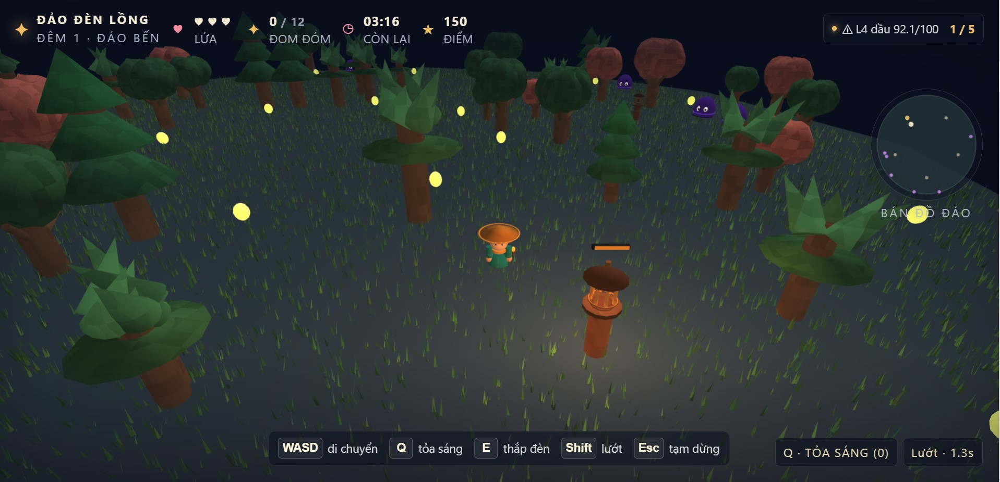

# Đảo Đèn Lồng

> **Video demo:** [xem MP4 (4:13)](docs/demo/demo.mp4). Ảnh gameplay: [mở ảnh](docs/demo/gameplay.jpg). Browser benchmark hiện chưa có report hợp lệ; chi tiết ở [bằng chứng Phase 4](docs/proof/phase-4.md).



Game phiêu lưu 3D góc nhìn thứ ba trên ba hòn đảo giữa biển mây. Điều khiển Mây gom đom đóm, thắp đèn và tránh Bóng Mực qua ba đêm. Renderer WebGL tự viết; mô phỏng headless chạy bằng Node.js, không cần thư viện ngoài.

## Chạy game

Cần Node.js 18 trở lên và trình duyệt hỗ trợ WebGL.

```sh
npm run build
npm start
```

Mở <http://localhost:4173>.

## Điều khiển

- `W A S D` hoặc phím mũi tên: di chuyển theo góc camera; kéo chuột để xoay camera.
- `Space`: nhảy; `Shift`: lướt nhanh.
- `Q`: dùng một đom đóm tạo sóng sáng, đẩy lùi và làm choáng Bóng Mực gần đó.
- `E`: nạp đom đóm vào đèn gần nhất trong 2,6 m; đèn chưa từng sáng cần 10, thắp lại cần 5.
- `Esc` hoặc `P`: tạm dừng. Cài đặt gồm âm lượng, độ nhạy camera, bảng màu dễ phân biệt, giảm chuyển động, chữ lớn và đổi phím.
- Màn hình cảm ứng có joystick và nút hành động.

## Luật và điểm

Mỗi bước mô phỏng là 1/60 giây. Thời lượng theo tuning hiện hành là Đêm 1: 4 phút, Đêm 2: 4 phút 30 giây, Đêm 3: 5 phút. Khi bình minh, cần giữ sáng ít nhất 60% số đèn; nhánh hết lửa được xét trước kết quả bình minh. Đèn tự hao 1 nhiên liệu/giây; Bóng Mực đang hút dầu làm hao thêm 5/giây. Mỗi đom đóm nạp cho đèn thêm 10 nhiên liệu.

- Nhặt đom đóm: không cộng điểm.
- Nạp đom đóm vào đèn: `+5` mỗi đom đóm.
- Thắp đèn lần đầu: `+100`; thắp lại: `+40`.
- Sóng sáng làm choáng Bóng Mực: `+5`; nếu nó đang hút dầu: `+15`.
- Sống đến bình minh: mỗi đèn còn sáng cộng `50 + floor(nhiên liệu)`; mỗi lửa còn lại cộng `50`. Không có thưởng theo thời gian còn dư.

Sức chứa bắt đầu là 10, tăng 2 sau mỗi lần thắp thành công và tối đa 20. Đêm 2 có hai đảo nối bằng cầu và bệ phóng; Đêm 3 có nhiều tầng, gió mạnh và vật phẩm tăng tốc.

## Chế độ headless / Contract v1.3

Tuning chuẩn nằm trong `game.contract.json`; mô phỏng không mở cửa sổ và không dùng GPU. Chạy từng đêm bằng `--night 1`, `--night 2` hoặc `--night 3`:

```sh
npm run verify
node src/cli.js --seed 7 --night 2 --ticks 600 --out run.jsonl
```

Có thể thêm `--scenario <file.json>`, `--inputs <file.json>` và `--snapshot-every <int>`. JSONL bắt đầu bằng snapshot tick 0 và kết thúc bằng record `end`; các lần chạy cùng seed, scenario và inputs cho output giống nhau. `npm run build` kiểm tra cú pháp JavaScript.

Đo renderer bằng Chrome/Edge ở 1280×720 và chạy soak 10 đêm:

```sh
npm run bench -- --seed 42 --duration 30 --out docs/proof/bench.json
npm run soak -- --seed 7 --nights 10 --out docs/proof/soak.json
```

## Sáng tạo của tôi

- Ánh sáng đèn lồng mở rộng dần trong vài giây sau khi thắp; thanh nhiên liệu nằm trên thân đèn, để ánh sáng vẫn rõ mà không che lồng đèn.
- Sóng Q lan ra thành hai vòng sáng; hiệu ứng đặt quanh Mây thay vì phủ một quả cầu lên nhân vật.
- Bóng Mực có mắt sáng và tự đi tuần khi chưa phát hiện Mây; cây có thân, tán và nhiều biến thể bố trí theo seed.

Các phần trình bày nằm trong [renderer](src/renderer.js); kiểm tra mô phỏng và tính tất định bằng `npm run verify`. Tính năng hình ảnh cần được thể hiện trong video demo khi bổ sung.

## Tài liệu và trạng thái nộp

- [Contract](game.contract.json), [lịch sử thay đổi](CHANGELOG.md), [đặc tả Phase 2](docs/spec/phase-2.md).
- [Giả định Phase 1](docs/notes/phase-1.md), [quyết định và kế hoạch Phase 3](docs/notes/phase-3.md).
- [Ghi chú Phase 4](docs/notes/phase-4.md), [retro](docs/notes/retro.md), [bằng chứng Phase 1](docs/proof/phase-1.md), [Phase 2](docs/proof/phase-2.md), [Phase 3](docs/proof/phase-3.md), [Phase 4](docs/proof/phase-4.md).
- [Kịch bản quay video demo và vị trí lưu media](docs/demo/QUAY-DEMO.md).
- [Hướng dẫn agent](AGENTS.md), [CREDITS](CREDITS.md), [LICENSE](LICENSE), [checklist nộp bài](SUBMISSION.md).
- Repo đang Public; tag `phase-4`, tag `v1.0.0` và Release `v1.0.0` đã được đẩy lên GitHub. Tag `phase-1` đến `phase-3` còn thiếu vì lịch sử hiện có không lưu các commit game ở những mốc đó.
